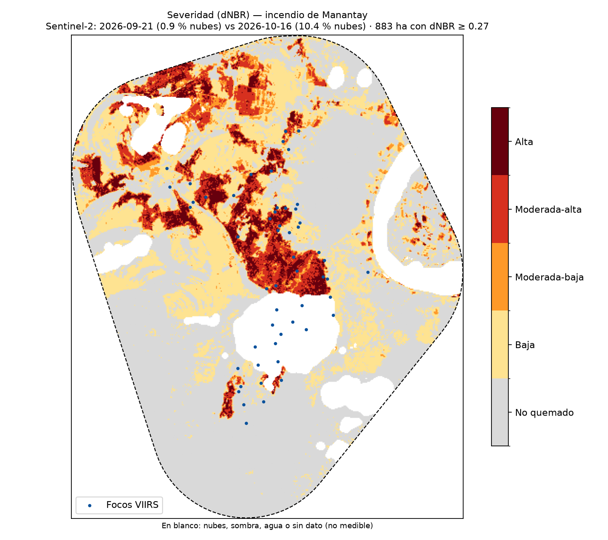
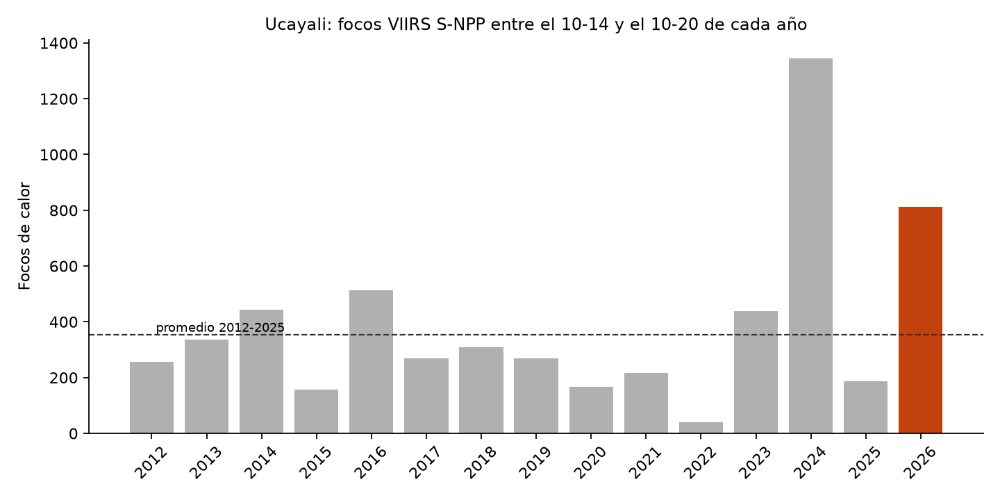

# Incendio de Manantay (Ucayali), octubre de 2026: ¿cuánto se quemó y es un año récord?

Tarea del curso *Ciencia de datos con Python* (Universidad del Pacífico) · Retos A + E.

## La pregunta

¿Cuántas hectáreas quemó el incendio de Manantay detectado entre el 2026-10-15 y el 2026-10-16, y los focos de calor de esta semana en Ucayali son récord frente a las mismas fechas de 2012-2025?

## Tres hallazgos

1. **883 ha quemadas** (dNBR ≥ 0.27) dentro de una zona de estudio de 5,879 ha. Con un umbral más estricto (0,44) o más laxo (0,10) la cifra va de 636 a 2,188 ha: el número depende del umbral.
2. **72 % del área quemada tiene severidad moderada-alta o alta**, y el 100 % está en el distrito de Manantay (UBIGEO 250107).
3. **Ucayali registra 812 focos entre el 2026-10-14 y el 2026-10-20**, +130 % frente al promedio de esas fechas en 2012-2025 (353); 2026 ocupa el puesto 2 de 15 (el máximo fue 1346 focos en 2024). A nivel nacional la variación es +97 % (puesto 2 de 15). Departamentos en récord esa semana: Junin, Cusco, Apurimac, Ancash, Arequipa, Huancavelica, Moquegua, Ica, Tacna.

## Mapa





## Datos y fechas

| Dato | Fuente | Fecha usada |
|---|---|---|
| Focos de calor 2026 | NASA FIRMS, VIIRS S-NPP «South America 7d» (tiempo casi real) | 2026-10-14 a 2026-10-21 |
| Focos 2012-2025 | NASA FIRMS, archivo anual por país «viirs-snpp Peru» | mismas fechas de cada año |
| Imagen antes | Sentinel-2 L2A, Microsoft Planetary Computer | 2026-09-21 (0.9 % nubes en la zona) |
| Imagen después | Sentinel-2 L2A, Microsoft Planetary Computer | 2026-10-16 (10.4 % nubes en la zona) |
| Límites con UBIGEO | INEI vía GitHub juaneladio/peru-geojson | — |

## Método

1. **Focos** (`01_focos.py`): focos S-NPP de confianza nominal o alta; un incendio es un grupo de focos a ≤ 1 km y ≤ 48 h entre sí. Se tomó el grupo más grande que toca Manantay: 54 focos. Zona de estudio = envolvente del grupo + 2 km.
2. **dNBR** (`02_dnbr.py`): NBR = (B08 − B12)/(B08 + B12) a 20 m; dNBR = NBR antes − NBR después. La imagen «después» es la de menos nubes tras el primer foco. La imagen «antes» se eligió manualmente: se usó la del 21-sep en vez de la del 14-ago (que tenía igual o menos nubes) porque está más cerca del incendio y reduce los cambios por estación y por chacras. Nubes, sombras, agua y sin dato se enmascararon con la capa SCL; quedó medible el 85.9 % de la zona. Clases de severidad USGS.
3. **Año récord** (`03_anio_record.py`): conteo de focos por departamento en las mismas fechas de 2012 a 2026, solo S-NPP. En la serie histórica se usan focos de vegetación (tipo 0); en 2026 se quitaron 67 focos a ≤ 1 km de fuentes fijas o volcanes conocidos.

### Hectáreas por severidad

| Clase | ha |
|---|---|
| No quemado | 2,860.4 |
| Baja | 1,304.4 |
| Moderada-baja | 247.5 |
| Moderada-alta | 398.4 |
| Alta | 237.6 |

### Hectáreas quemadas por distrito

| UBIGEO | Distrito | ha |
|---|---|---|
| 250107 | Manantay | 883.4 |

## Limitaciones

- Un foco de calor no es un incendio: es un píxel de ~375 m más caliente que su entorno en el momento del paso del satélite. Incendios pequeños, de sotobosque o bajo nubes no se detectan.
- Las nubes y el humo esconden el fuego: solo el 85.9 % de la zona fue medible; el área quemada es un mínimo.
- La imagen del 16-oct se tomó con el fuego aún activo, así que el área quemada es un mínimo.
- En el noroeste de la zona hay parches rectangulares con dNBR alto que parecen quemas o limpieza de chacras ajenas a este incendio; están incluidos en las hectáreas, por lo que la cifra puede estar sobreestimada en esa parte, mientras que las nubes y el humo sobre el sur la subestiman.
- El umbral de dNBR cambia el resultado (ver hallazgo 1). En la Amazonía, la quema agrícola y la deforestación previa también bajan el NBR.
- Los focos de 2026 son de tiempo casi real y los históricos de archivo procesado; la diferencia mensual entre ambos es pequeña, pero no nula.
- Es una herramienta independiente: no reemplaza las cifras de COEN, INDECI, SERFOR ni SERNANP.

## Cómo reproducir

```bash
pip install -r requirements.txt
python 01_focos.py
python 02_dnbr.py            # o forzar fechas: --pre AAAA-MM-DD --post AAAA-MM-DD
python 03_anio_record.py
python 04_readme.py
```
